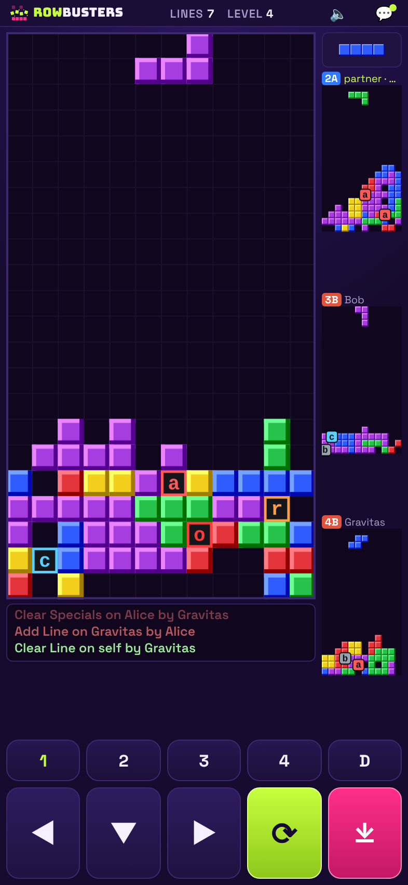

# Rowbusters

**Clear lines. Send trouble.** Multiplayer block-dropping action — a study project.

It is an online block-stacking game for up to 4 players with special attack blocks, built to run in the browser of iPhones and Linux phones (PinePhone / Librem 5 with Phosh or Plasma Mobile, Firefox or GNOME Web).



## Play it

**https://rowbusters.com**

A copy also runs on GitHub Pages (https://fmlacerda.github.io/BlocksNet/). Once rowbusters.com is live, that copy sends players there automatically, bringing their saved nickname, settings and ranking identity along (each web address keeps its own saved data). Add `?stay` to the GitHub address to stay on it.

To run it locally there is no build step and there are no dependencies. Serve the repo root and open it on the phone:

```sh
python3 -m http.server 8000
# phone on the same Wi-Fi → http://<your-computer-ip>:8000/
```

On iOS use *Share → Add to Home Screen*, and on Linux phones use *Install / Add to home*, so it runs full-screen like an app.

## Brand

Rowbusters (formerly BlocksNet). The logo is a row of blocks bursting apart, with **ROW** in lime and **BUSTERS** in white, in Bungee; all other text uses Space Grotesk (both from Google Fonts). Palette: deep violet `#160B2E` background, `#1F1240` / `#251550` panels, `#34205E` lines, `#F5F0FF` text, `#A99BCB` secondary text, lime `#C6FF3D` (main buttons, highlights) and hot pink `#FF2E88` (hard drop, Multiplayer, spectating). The colours live as CSS variables at the top of `css/common.css`. Block and special colours are part of the game, not the brand, and are unchanged. A 4-line clear is called a **rowbust**.

The online server keeps its original Cloudflare name `blocksnet` (`blocksnet.fmlacerda.workers.dev`): renaming the Worker would start a new server with an empty ranking. Phones that played as BlocksNet keep their nickname, settings and ranking identity (saved data is copied from the old keys on first launch).

## Layout and controls

Portrait, one hand-held layout:

- **Top line:** game name, lines, level, a sound on/off button and the partyline chat button (a dot means unread messages).
- **Your field** on the left, sized to the largest the screen allows. Under it are your specials (the first one is used next) and a 3-line action ticker: new events slide in at the bottom, older ones move up and fade, and each disappears after about 7 seconds. Tap the ticker for the full history.
- **The 3 opponents** stacked on the right, with the next piece above them. Tap an opponent to fire your special at them.
- **Buttons:** 1–4 fire your first special at that player and D discards it. Below are ◀ ▼ ▶ to move and soft-drop, ⟳ to rotate (one direction only) and ⤓ to hard-drop.

Keyboard also works for desktop testing: arrows to move, ↑/X/Z to rotate, Space to drop, 1–4 to fire a special, D to discard.

lock palette with bevelled blocks.
- Up to 4 players with slot numbers 1–4, online with friends and/or bots.
- Classic line sending: clearing 2 lines sends 1 to every opponent, 3 sends 2, 4 sends 4.
- Specials appear on your field when you clear lines. Clearing the line that holds one banks it (inventory of up to 18). Default frequencies:
  `a` Add Line · `c` Clear Line · `n` Nuke Field · `r` Random Clear · `s` Switch Fields · `b` Clear Specials · `g` Block Gravity · `q` Blockquake · `o` Block Bomb.
- Game speed settings in the lobby: **Speed** preset (Relaxed, Classic, Fast, Turbo, Insane), **Start level** (1–50) and **Level up** every 1–10 lines. Bots speed up to keep pace.
- Level and gravity speed-up, junk-filled field when eliminated, attack/defense log, partyline chat, and a winlist stored on the device.
- Bots use a heuristic placement AI and use specials sensibly (gravity/nuke on themselves when high, switch when losing, and so on).

## Sound

Short retro sound effects are generated in the browser (Web Audio), so there are no audio files and no music. They play when you move, rotate, soft-drop, land or hard-drop a piece, clear lines (1–4 rising notes), collect a special, fire one, get hit by an attack or lines, receive a helpful special, get chat, get eliminated and win. Only your own actions and attacks aimed at you make sound. The 🔈 button in the top line mutes it, and the setting is remembered. On iPhone the game plays even when the silent switch is on, like a video would (use the 🔈 button instead). If you hear nothing, tap **Test sound** in the lobby: it plays three notes and shows the audio status (e.g. `audio running · game sound on`).

## Fullscreen

- **Android and Linux phone browsers** (Firefox, Chromium, GNOME Web): leave *Play fullscreen* ticked in the lobby. The game goes fullscreen and locks to portrait when you tap Start.
- **iPhone**: Safari has no fullscreen mode for web pages. Use *Share → Add to Home Screen* and launch Rowbusters from the icon. It then opens without browser bars (the lobby shows this tip on iPhone).

## Updates

The game checks `version.json` when it opens and whenever it comes back to the front. If the phone is showing an older saved copy, it reloads itself with the new version (only in the lobby, never mid-game or in an online room). When publishing a change, bump the version in both `version.json` and `js/engine.js` (`RB.VERSION`), and the `?v=` tags in `index.html`.

The `stable` branch holds the last known-good version for quick rollback.

## Code layout

```
js/engine.js   rules: Player, Room (routes lines/specials), BotBrain
js/render.js   canvas drawing: fields, next piece, special bar
js/sound.js    synthesised sound effects (Web Audio)
js/net.js      online rooms: PeerJS / same-browser transports, host relay, room codes, invites
js/app.js      shared shell: lobby, online room screens, game loop, keyboard, buttons, winlist, haptics
js/config.js   server address for public rooms; optional extra TURN relays
server/        game server for public rooms and ranking (Cloudflare Worker)
wrangler.jsonc Cloudflare deploy settings
js/vendor/     PeerJS 1.5.5 (MIT)
css/common.css shared tokens, overlays, log colours
index.html     the game page: layout and button wiring
```

## Public rooms and ranking (server)

The **Multiplayer** button opens seven public rooms (Room 1–7, up to 4 players each) and the top-players ranking (all time and this week). Joining a room opens its Partyline chat; the first player in the room is the host and starts the game (bots can fill empty seats); if the host leaves, the next player becomes host.

**Room game modes:** rooms 1, 2 and 4 play normal games. **Room 3 is Teams (2 vs 2)**: in the Partyline each player taps **Team A** or **Team B** (2 players per team; newcomers join the smaller team, and you can switch between games). Lines you send (2, 3 or 4 cleared at once) hit only the other team, never your partner; specials can still be used on anyone, so you can help your partner (e.g. a Nuke on a partner in trouble). Bots added by the host join the smaller team, and a game needs at least one player on each team. The last team with a player left wins; in the ranking every real player on the winning team gets the win. In the game your partner's field is marked "partner" and each small field shows its team (blue A, red B). **Room 5 is SNS**: only sticks (I) and squares (O) fall. **Room 6 is Fast**: pieces fall 30% faster than the chosen speed. **Room 7 is Pure**: no specials at all; the only attack is the classic lines sent to opponents when you clear 2, 3 or 4 lines at once. The room sets the mode (the server enforces it; the host still picks speed, start level and level up), its card on the Multiplayer screen and its Partyline show it, and a line in the game log announces it when a game starts. Private rooms and games against bots are always normal.

**Short connection drops:** if a player's connection drops during a game (network blip, phone switching networks), the server keeps their seat and their bots for 10 seconds. The phone keeps playing and reconnects, and the game simply goes on. A player who doesn't come back in time is out of that game; leaving on purpose counts immediately.

**Watching:** anyone who joins a room during a game sees it live right away and plays in the next game. When all 4 seats are taken, the room card offers **Watch** instead (up to 8 spectators). Spectators get a free seat automatically when a game ends. While watching, the big field follows one player (tap a small field to switch), the controls are hidden and **Leave** returns to the room list. Spectators can chat.

**Round stats:** after each game in a public room, everyone in the room (spectators too) gets a stats card in the Partyline chat, like the classic servers' end-of-game stats. Per player: place, time survived, pieces per minute (PPM), lines cleared, rowbusts (4 lines cleared at once), lines sent and specials used/received. Below it are awards for the single best player (💣 top attacker: lines sent plus attacks on others; ⚡ fastest, needs 30 s of play; 💥 most rowbusts; no award on a tie) and 🎯 who hit you most. Ranked games also add to your all-time totals (lines, rowbusts, average and best PPM, lines sent, specials used), shown under your rank on the Multiplayer screen. Lines and specials sent are counted by the server from the messages it relays; pieces, lines cleared and rowbusts are counted by each phone (with sanity caps). From the second game in a room, the card gets a **📊 Summary · N games** button. It opens a summary of every game since you joined the room: a wins scoreboard, a game-by-game table (winner, time, lines and lines sent per player), totals per player (games won, lines cleared and sent, rowbusts, average PPM, specials used) and a few highlights (winning streaks, quickest and longest game, most rowbusts, most lines sent). Players are matched by nickname, and bots keep the same names in a room until it empties, so they are counted too. **Copy stats** (on each card and on the summary) puts it on the clipboard as plain text, ready to paste into a chat app. Private rooms and games against bots don't show stats.

These rooms run on a small server, `server/worker.js` (a Cloudflare Worker with one Durable Object), configured by `wrangler.jsonc`:
- Phones connect to it with a WebSocket and it relays the game messages, so no phone-to-phone connection is needed (works on any network).
- The server checks that each phone only sends messages for its own players, and it decides when a game ends and who won.
- Results go into the ranking (SQLite in the Durable Object). Only games with at least 2 real players count. Players are identified by nickname plus a random id stored on the phone.

**Deploying:** one Cloudflare Worker (`blocksnet`, created with *Workers & Pages → Create → Import a repository →* this repo) serves both the game files and the server, and Cloudflare redeploys it on every push to `main`. `wrangler.jsonc` sets this up: the repo root is served as static files (minus what `.assetsignore` lists: server code, config, README, docs), and any other request (`/lobby`, `/ws/room/<n>`, `/health`) goes to `server/worker.js`. The domain is attached in the dashboard (*Worker → Settings → Domains & Routes → Add → Custom domain*: `rowbusters.com`, and `www.rowbusters.com`). On rowbusters.com the game talks to its own address; other copies use `https://blocksnet.fmlacerda.workers.dev` (`js/config.js`). To test locally, run `npx wrangler dev` and open `http://127.0.0.1:8787/?server=http://127.0.0.1:8787`.

## Online multiplayer (private rooms, phone-to-phone)

Up to 4 players on their own phones, with bots filling any empty slots.

1. One player taps **Host a room**. The **Partyline** chat room opens with a 5-character room code.
2. Friends tap **Join a room** and enter the code, or open the invite link from **Invite** (`…?join=CODE`). They arrive in the same chat room ("Bob joined the room").
3. Everyone can chat there. When ready, the host picks how many bots to add and taps **Start game**. Only the host can start; the host's speed settings apply to everyone.
4. After each game, everyone returns to the Partyline with the winner announced, and the host starts the next round from there.

**How it works.** Phones talk directly to each other over WebRTC, using PeerJS (bundled in `js/vendor/`, MIT licence). The free PeerJS cloud server only introduces the phones; no game data goes through it, and nothing needs hosting besides these static files.
- **Each phone runs its own field.** The phone sends its field about 10 times a second, plus every line attack, special and chat message.
- **The host relays.** Guests connect only to the host, which relays messages between them, runs the bots and decides when the game ends.
- **Guests are checked.** The host only accepts messages a guest sends for its own player, and player names are stripped of anything but letters, digits and simple punctuation.

**If the connection drops:** a guest stays in the Partyline and reconnects automatically for up to 45 seconds; a game in progress continues without them and they play the next one. Both sides send a small heartbeat every 4 seconds, so a dead link is noticed within about 15 seconds. When the host leaves, guests see "The host closed the room".

**Troubleshooting:** the lobby shows the game version (e.g. `v2026.10.09a`) and a **connection details** link; the Partyline has a **Connection details** button too. It shows each step (connection server, network addresses found, how the phones connected, drops and reconnects), with a Copy button. To add your own TURN relay for players on mobile data, edit `js/config.js`.

**Things to know:**
- The room lives on the host's phone. If the host closes the page or locks the phone, the game ends for everyone.
- Online games can't pause. A phone that goes to the background stops sending, and iOS may drop the connection.
- Some strict networks (certain mobile carriers, corporate Wi-Fi) block direct connections. PeerJS then falls back to its free relay servers, which can be slow or busy. If joining fails, try another network.
- **Testing on one computer:** add `?net=local` to the URL and use two tabs of the same browser. No internet is needed.
- **Own connection server:** run a [PeerServer](https://github.com/peers/peerjs-server) and add `?peerhost=your.host&peerport=443&peersecure=1&peerpath=/` to the URL. Invite links keep these settings.

## Packaging for app stores later

- **iOS**: wrap the same files with Capacitor (WKWebView).
- **Linux phones**: package as a Flatpak using WebKitGTK, or just ship it as an installed PWA.
